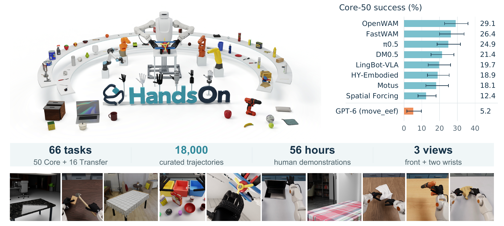
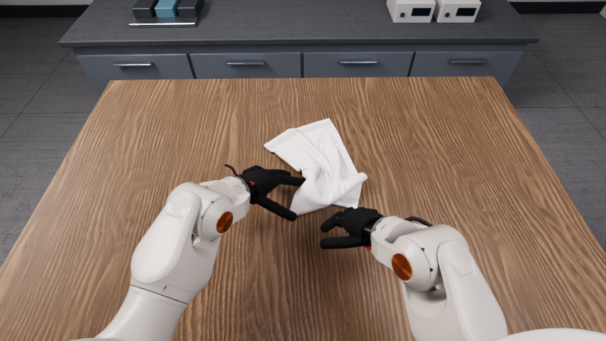

<p align="left">
  <picture>
    <source media="(prefers-color-scheme: dark)" srcset="docs/pics/naturewill-logotype-dark.svg">
    
  </picture>
</p>

<p align="center">
  <picture>
    <source media="(prefers-color-scheme: dark)"
            srcset="docs/pics/handson-lockup-dark.png 1x, docs/pics/handson-lockup-dark@2x.png 2x">
    
  </picture>
</p>

**A Large-Scale Simulation Benchmark for Generalizable Dexterous Manipulation**

<p align="center">
  <a href="https://llltttwww.github.io/HandsOn-website/"></a>&emsp;
  <a href="https://arxiv.org/abs/2610.26765"></a>&emsp;
  <a href="https://huggingface.co/datasets/Cyan666/HandsOn-Datasets"></a>
</p>

HandsOn is a simulation data platform and benchmark for dexterous manipulation,
built on NVIDIA Isaac Sim 5.1 with a ROKAE–Wuji bimanual platform.  It provides
**66 tasks** verified through human demonstrations, **18,000 curated
demonstrations** (6,053,555 timesteps at 30 Hz), high-fidelity re-rendering, and
visual and goal-preserving prompt randomization.

<p align="center">
  
</p>

> **Dataset release status:** The currently released dataset was collected with
> the **PhysX backend**. The **Newton backend dataset is to be released**.

- **Core-50** — 50 tasks with demonstrations and execution tests, spanning
  functional tool use, numerical and spatial grounding, articulation,
  pick-and-place, and bimanual coordination.
- **Transfer-16** — 16 evaluation-only tasks, with no target-task
  demonstrations, covering asset and relation transfer, skill composition
  (6 compositional tasks), and deformable manipulation (3 tasks).

## Repository layout

```
handson/                    Python package
  handson/interfaces.py     shared policy protocol and validation
  handson/eef52.py          measured state and physical action adapter
  handson/tasks/            unified registry, native factories and language assets
  handson/sim/isaaclab/     Isaac Lab environment implementations
  handson/sim/isaacsim/     Isaac Sim runtime helpers
  handson/sim/envs/         shared env utilities and task assets
  handson/robots/           portable robot descriptions and source catalog
  handson/runtime/          task registry and runtime support
  handson/evaluation/       shared rollout, transports and paper protocol data
  handson/policies/         paper model registry, adapters and native sources
  handson_openpi_client/    compatibility alias for the evaluation entry
configs/                    per-task evaluation configs
  multi_task/               one YAML per released task (66)
  rand_obj/                 legacy object-randomization configs (8 tasks)
  rand_full/                legacy full-randomization configs (8 tasks)
taskdev/                    task-development contract and acceptance gate
scripts/                    collection, playback and validation utilities
openpi/                     adapted OpenPI π0.5 training/serving stack
```

## Task naming

Every task is named `<paper-id>_<paper-name-slug>`:

| Range | Meaning |
|---|---|
| `t01_…` – `t50_…` | Core-50, numbered as in the manuscript |
| `eval_comb01_…` – `eval_comb06_…` | Transfer-16 compositional tasks |
| `eval_gen01_…` – `eval_gen07_…` | Transfer-16 generalization tasks |
| `eval_flex01_…` – `eval_flex03_…` | Transfer-16 deformable tasks |

The `t` prefix keeps each directory importable as a Python module.  The number
is the task id used in the manuscript.

Examples: `t12_load_and_start_microwave`, `t37_scrub_bottle`,
`eval_comb02_open_laptop_and_click_mouse`, `eval_flex02_fold_towel_twice`.

A one-line description of every task is in **[docs/tasks.md](docs/tasks.md)**.

## Installation

The default PhysX environment requires **Python 3.11**, NVIDIA Isaac Sim **5.1.0.0**,
Isaac Lab **v2.3.2** (Python package version 0.54.2), and an NVIDIA GPU.
Use the NVIDIA installation instructions for the simulator and Lab. In that
environment, install HandsOn from the repository root:

```bash
python -m pip install -c requirements/simulator-constraints.txt -e ./handson
python -m pip check
```

The package uses `numpy==1.26.0` and `typing-extensions==4.12.2` as required by
Isaac Sim 5.1, and `gymnasium==1.2.1` as required by Isaac Lab v2.3.2.
Model servers have separate environments; see [paper models](docs/paper-models.md).
See [installation and testing](docs/installation.md) for the CPU test lock,
upstream NVIDIA dependency conflicts, and validation limits.

The optional [Newton evaluator](docs/newton-evaluation.md) uses a separate
Python 3.12 / Isaac Sim 6 environment. Its current task scope is insert-peg and
place-fruit-in-bucket, with the same default appearance and policy interface.

## Quick start

The demonstration dataset is optional. The paper ROKAE/Wuji robot and prepared
rendering assets are bundled, with [source and license records](docs/robot-assets.md).
Install `ffmpeg` on `PATH` and run the evaluation entry with held measured commands:

```bash
python -m handson.evaluation --list
python -m handson.evaluation --task t12_load_and_start_microwave \
    --diagnostic-steps 90 --seed 0 --output outputs/microwave
```

This writes three camera videos, initial/final PNGs and runtime receipts.
It is a diagnostic and does not produce a policy score.

## Evaluation

The release includes adapters for π0.5, DM0.5, HY-Embodied-0.5-VLA,
LingBot-VLA, OpenWAM, FastWAM, Motus, Spatial Forcing and single-task DP.
Follow [paper model evaluation](docs/paper-models.md) to install the separate
inference environment and launch the selected checkpoint. Then, in the
simulator environment:

```bash
python -m handson.evaluation --model openwam --task t12_load_and_start_microwave \
    --policy-url http://127.0.0.1:8000 --policy-metadata policy-metadata.json \
    --seed 0 --output outputs/openwam-microwave
```

The model profile selects the correct execution length and history settings.
The default evaluator uses the paper's native EEF52 execution and three-view
capture code. A custom OpenPI websocket policy can also use the transport entry:

```bash
pip install -e ./openpi/packages/openpi-client
python -m handson.evaluation --task t12_load_and_start_microwave \
    --host 127.0.0.1 --port 8000 --seed 0 --output outputs/policy-microwave
```

All 66 PhysX tasks use this entry. Actions execute at 30 Hz under the published
3×P75 budgets (with three deformable-task native-duration exceptions).
Task settings are selected before construction; one instruction is sampled
from the paper language bank for the actual reset goal. See [the policy contract](docs/custom_policy_integration.md)
for transports, checkpoint identity, history inputs and scoring exceptions.

The previous `handson_openpi_client.cli.evaluate --config ...` command is an
alias to this evaluator. It reads only `env_name` from the YAML; old camera,
hand, prompt and timeout fields do not override the packaged protocol.

## Default rendering

The release includes ROKAE arm and Wuji hand meshes, converted visual layers,
routed wrist cables, station CAD and PBR room materials. Preview, native
environment and replay use these bundled assets by default. They are installed before physics initialization; task
objects, collision geometry, controllers and success conditions are preserved.
The renderer uses path tracing with 32 samples per pixel. No appearance switch
is required. Missing or altered assets produce an integrity error.



**EVAL-Flex02 — Fold Towel Twice.** Two hands grasp and fold a deformable towel,
creating folds and wrinkles through contact-rich cloth manipulation.

Verify the installed asset bundle without starting the simulator:

```bash
python -m handson.sim.isaaclab.render_assets
```

The preview writes the image and a `.render.json` receipt identifying the
loaded assets and physical-scene invariance checks. Its operator camera is
separate from the environment's policy observation cameras. See
[rendering](docs/rendering.md) for the asset and capture contracts.

The installed-package validation results, task matrix and three-view samples are in [release validation](docs/release-validation.md).

## Dataset

The currently released demonstration dataset was collected with the **PhysX
backend** and is distributed on the Hugging Face Hub. The **Newton backend
dataset is to be released**.

| Backend | Release status | Contents |
|---|---|---|
| **PhysX** | Released: [`HandsOn-Datasets`](https://huggingface.co/datasets/Cyan666/HandsOn-Datasets) | 18,000 curated trajectories (15,178 train / 2,822 validation), in LeRobot v2.1 format |
| **Newton** | **To be released** | — |

18,000 trajectories / 6,053,555 timesteps at 30 Hz, with three synchronized
RGB streams per episode (front 854×480, two wrist views at 848×480).  The
package also carries `norm_stats.json`, the split definition, and the
provenance manifests used for the manuscript's checksums.

```bash
pip install "huggingface_hub[cli]"
hf download Cyan666/HandsOn-Datasets --repo-type=dataset --local-dir ./handson-data
```

`meta/info.json` describes the feature schema; `code/training_reader.py`
inside the package reads the split directly:

```bash
python -m pip install numpy pyarrow av Pillow
```

```python
from pathlib import Path
import sys

root = Path("handson-data").resolve()
sys.path.insert(0, str(root / "code"))
from training_reader import HandsOnDataset

dataset = HandsOnDataset(root, horizon=16, split="train")
dataset.set_epoch(0)
sample = dataset[0]
print(sample["observation.state"].shape)  # (52,)
print(sample["action"].shape)             # (16, 52)
```

The reader indexes frames and provides episode-end padding masks, active-side
masks and three camera images. See the dataset card for schema and split details.

## Task acceptance

`taskdev/` contains the fail-closed contract used to accept each task.  Every
task report must pass all nine checks — `schema`, `assets`, `reachability`,
`contact`, `reset`, `success`, `camera`, `stability`, `collection` — with
measured evidence, or the task is rejected.

## Results

Over 40,000 Core-50 episodes across diffusion policies, vision-language-action
models, and world-action models, the best of eight multi-task checkpoints
reaches **29.1% task-macro success**.  Success is 35–51% for pushing,
articulation, and pick-and-place but only 2–3% for tool use and precision
fitting.  Transfer-16 shows the largest remaining headroom.

The study also evaluates **GPT-6 with `move_eef`**, without HandsOn
demonstrations or finetuning: **26/500 (5.2%)** on Core-50 and **3/160 (1.9%)**
on Transfer-16, or **29/660 (4.4%)** overall. Each of the 66 tasks contributes
ten trials, reflecting API-cost and wall-clock evaluation-time budgets.
The prompted controller has a different observation and interaction budget
from the trained policies. Its qualitative traces suggest task-level planning
strategies, while the minimal palm-and-finger interface leaves substantial
execution challenges. See the [GPT-6 results and protocol](docs/gpt6-results.md)
for per-task outcomes, measured diagnostics, and comparison limits.

These numbers come from the manuscript's evaluation.  Reproducing them end to
end additionally requires the policy checkpoints, which are **not** distributed
with this repository; see the manuscript for the training recipe.  The environments, protocol data and success predicates are packaged here.
Runtime diagnostics and a trained checkpoint evaluation are separate checks;
matching a manuscript score also requires its checkpoint, seed/goal selection
and language protocol.

## Reproducibility

| Artifact | Where |
|---|---|
| Environments, task definitions, success predicates | this repository |
| Evaluation configs | `configs/multi_task/*.yaml` |
| GPT-6 660-trial results | [Protocol and results](docs/gpt6-results.md), [JSON](docs/results/gpt6-results-20261019.json) |
| Task acceptance evidence | `taskdev/tasks/*/validation_report.yaml` |
| PhysX demonstration dataset | [Hugging Face](https://huggingface.co/datasets/Cyan666/HandsOn-Datasets) |
| Newton demonstration dataset | To be released |
| Policy checkpoints | not redistributed; see the manuscript |

Determinism: each environment is seeded through `--seed`; the task's own
reset-layout sampling is seeded. Public task names change task-keyed language,
camera and setting draws, so an integer seed alone does not recreate a historical
manuscript trial. Simulator/driver differences and native reset rejection must
also be recorded.

## Contributing

Issues and pull requests are welcome.  For a new task, `taskdev/` defines the
acceptance contract a task must satisfy — see `taskdev/schema/` for the
manifest schema and `taskdev/templates/` for the starting documents.

## Acknowledgements

HandsOn is built on NVIDIA Isaac Sim and Isaac Lab.  HandsOn incorporates selected
task designs and assets from [DexJoCo](https://github.com/brave-eai/dexjoco) and
[DexVerse](https://github.com/ycyao216/DexVerse).  Detailed attribution and
adaptations are documented in the paper appendix and [repository notices](NOTICE).
Robot descriptions, manufacturer sources and license notices are listed in
[robot assets and attribution](docs/robot-assets.md).

## License

MIT — see [LICENSE](LICENSE).  Third-party components and task-design lineage
are noted in [NOTICE](NOTICE).

## Citation

```bibtex
@article{luo2026handson,
  title = {{HandsOn}: A Large-Scale Simulation Benchmark for Generalizable Dexterous Manipulation},
  author = {Luo, Tianwei and He, Yiming and Wu, Hongjin and Pan, Ting and Ren, Debin and Guo, Haorui and Yang, Junlin and Zuo, Yuxin and Kou, Zhehao and Yang, Kaisen and Lai, Zhuoqun and Ding, Yi and Yu, Jiale and Zhang, Yuchen and Qiu, Zijie and Li, Haozhan and Ding, Ning},
  year = {2026},
  journal = {arXiv preprint arXiv:2610.26765},
  doi = {10.48550/arXiv.2610.26765},
  eprint = {2610.26765},
  archivePrefix = {arXiv},
  primaryClass = {cs.RO},
  url = {https://arxiv.org/abs/2610.26765}
}
```
