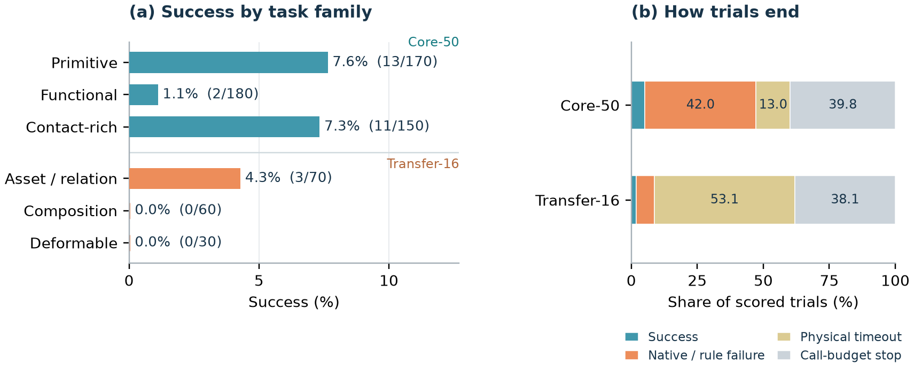

# GPT-6 with `move_eef`

HandsOn evaluates GPT-6 Astra at medium reasoning effort without task
demonstrations or benchmark finetuning. The single experiment contains ten
scored trials for every one of the 66 tasks. This allocation reflects API-cost
and wall-clock evaluation-time budgets while retaining the full task catalog.

| Suite | Tasks | Successes / trials | Success |
|---|---:|---:|---:|
| Core-50 | 50 | 26 / 500 | 5.2% |
| Transfer-16 | 16 | 3 / 160 | 1.9% |
| All | 66 | 29 / 660 | 4.4% |

Equal trial counts make task-macro and pooled success identical here.
The [machine-readable results](results/gpt6-results-20261019.json) include all
66 task rows and 660 scored outcomes, with source and result hashes. The
[manuscript (arXiv:2610.26765)](https://arxiv.org/abs/2610.26765)
provides the uncertainty analysis and full protocol.

## Interface and budgets

GPT-6 receives three RGB views, measured robot state, the task instruction,
static task guidance, and execution feedback. Its only exposed function is
`move_eef`: palm positions/orientations and up to 40 individual finger-joint
targets. It has no grasp primitive, obstacle-aware planner, explicit
object-pose estimate, or tactile feedback. Execution advances at 30 Hz; one
plan may execute 1–300 actions. API waiting does not advance physical time.

The final controller uses compact feedback, the latest two image turns, and
a 100-call cap. Completed trials retain their recorded context and call
budgets, including earlier settings. The reported experiment is therefore
not a uniform-100-call or compact-context ablation. Invalid or infeasible
calls consume the model-call budget without advancing physics. A budget stop
is an unsuccessful scored outcome. The episode count, call budget, and
physical-time limit are separate quantities.

All 660 outcomes and 1,980 three-view videos were checked on the server.
Open Latched Door retains the declared instruction/source discrepancy, and
Lift Carton waives the 12 N magnitude threshold while preserving its native
support, lift, and hold requirements. See the manuscript for these scoring
qualifications. Raw rollouts and videos remain on the evaluation server.

## Results and interpretation

| Task family | Successes / trials | Success |
|---|---:|---:|
| Primitive | 13 / 170 | 7.6% |
| Functional | 2 / 180 | 1.1% |
| Contact-rich | 11 / 150 | 7.3% |
| Asset / relation transfer | 3 / 70 | 4.3% |
| Skill composition | 0 / 60 | 0.0% |
| Deformable | 0 / 30 | 0.0% |

There are 29 successes, 260 call-budget stops, 150 physical-time limits, and
221 native/rule failures. Ten Core-50 tasks and two Transfer-16 tasks have at
least one success. Rotate Propeller reaches 7/10; Orient Cup Upright and Lift
Carton each reach 4/10. Contact-rich success comes entirely from Rotate
Propeller and Lift Carton, so it does not establish broad precision-fitting
competence. The Transfer-16 successes are Open Trash Bin (2/10) and Orient
Bottle Upright (1/10).

Qualitative traces show task-aware prerequisites and attempts to monitor
execution, even in unsuccessful trials. These observations motivate studying
GPT-6 as a high-level planner paired with richer state/contact estimates and
reusable manipulation skills. They do not measure planning accuracy over the
catalog or isolate the harness as the cause of failures. Matched evaluations
across richer agent harnesses are a future direction.

GPT-6 and the trained methods differ in observations, static guidance,
interaction budgets, and trial counts. The comparison should be interpreted
under these respective experimental conditions.

## Source

Results follow [manuscript revision 8a7634f](https://github.com/llltttwww/handson-arxiv-latex/commit/8a7634f5c9361d8be87956eaf37424d3109797a6).
The JSON is byte-identical to its `data/gpt6_results_20261019.json`, SHA-256
`0b39a05051ceb45c00e68a7da290ce63deaba3a7436b77504f3f07dc0ad9a50d`.
