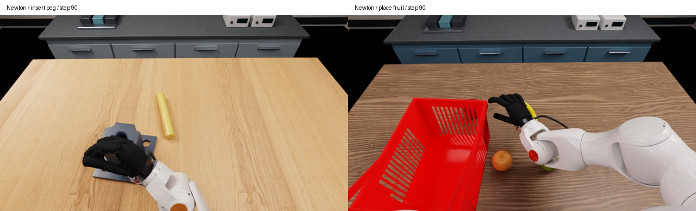

# Newton evaluation

The unified evaluator accepts `--physics-backend newton` for
`t09_insert_peg` and `t26_place_fruit_in_bucket`. It uses the same Wuji1 appearance,
three calibrated RTX cameras, model server, physical EEF52 actions and 30 Hz
control interface as the default PhysX evaluator. Other task identifiers fail
before launching the simulator. This is an integration release, not Newton
coverage of all 66 tasks or reproduction of the paper's PhysX scores.

Newton uses its native reset and solver. It does not load a recorded PhysX
state or apply the PhysX stable-origin gate. Results explicitly record
`physics_backend`, `paper_physics_protocol: false`, actual clocks and live
Newton state. Preserve that distinction when reporting results.

The adapter converts Lab 3's XYZW buffers to the same WXYZ/rotation-vector
policy boundary used on Lab 2. Camera poses are also published to USD/Fabric:
Newton's site-pose cache alone does not move an RTX camera. For the pinned
runtime, visual transforms use Newton's CPU Fabric hierarchy fallback; GPU
physics is unchanged. The cubric interface mismatch otherwise produced stale
robot meshes and an incomplete initial policy image.

## Runtime

Use a separate Linux x86_64 / Python 3.12 environment for Isaac Sim 6.0.1.0.
The renderer integration targets Isaac Lab commit
`ffff603eafc6b74264a5261cc0183d6a65390d78` (package version 6.1.14),
isaaclab-newton 0.13.6, Newton 1.4.0, Warp 1.15.0, MuJoCo 3.10.0 and
MuJoCo-Warp 3.10.0.3. Keep the Python 3.11 / Isaac Sim 5 PhysX environment
separate. The Newton installation helpers are:

```bash
# Requires curl, git, patch, and the NVIDIA runtime prerequisites.
bash scripts/install_isaacsim_newton_runtime.sh
bash scripts/run_newton_gpu_to_gpu.sh -m pip install \
  -c requirements/newton-simulator-constraints.txt -e ./handson
bash scripts/run_newton_gpu_to_gpu.sh -m pip check
```

The solver overlay includes the required velocity-projection patch. The
installer verifies its presence; do not bypass the check. To use an existing
installation, set `HANDSON_ISAACSIM_NEWTON_PYTHON` to its Python executable and
`HANDSON_NEWTON_GPU_TO_GPU_OVERLAY` to a separate overlay directory, then run
`bash scripts/install_newton_gpu_to_gpu_overlay.sh`. The launcher places that
overlay and the checkout on the Python path. Warp imports remain pinned across
Kit startup so that Kit cannot substitute its older Warp submodules.

Verify the bundled robot/render assets using the installation checks and install
`ffmpeg` before a GPU run. The existing installer is a bootstrap helper, not
certification of a clean installation on every machine. Record any NVIDIA
package dependency conflicts and use a driver supported by Isaac Sim 6.

## Run

Check the supported factories without starting a simulator:

```bash
bash scripts/run_newton_gpu_to_gpu.sh -m handson.evaluation \
  --physics-backend newton --list
bash scripts/run_newton_gpu_to_gpu.sh -m handson.evaluation \
  --physics-backend newton --check
```

Start a selected DP checkpoint in the separate [model environment](paper-models.md):

```bash
python scripts/serve_paper_policy.py --model dp --task t09_insert_peg \
  --checkpoint /models/dp/t09_insert_peg.pt \
  --metadata-output outputs/peg-policy.json --port 8000
```

Then run real policy inference on rendered observations in the Newton environment:

```bash
bash scripts/run_newton_gpu_to_gpu.sh -m handson.evaluation \
  --physics-backend newton --task t09_insert_peg --model dp \
  --policy-url http://127.0.0.1:8000 --policy-metadata outputs/peg-policy.json \
  --max-policy-steps 90 --seed 1 --output outputs/newton-peg
```

`--max-policy-steps` bounds real checkpoint inference and execution for an
integration check. It sets `counts_as_formal_trial: false`; remove it to run
the full task budget. `--diagnostic-steps 90` instead holds measured targets
without a policy. The options cannot be combined. Every attempt needs a new
output directory. Other model servers use the same transport and their existing
`--model` execution profiles, but a working DP check does not certify all model
checkpoints on Newton.

Outputs include initial/final images, three videos, camera pose/lens/exposure
readback, `PHYSICS_BACKEND.json`, `NEWTON_RESET.json`, checkpoint identity,
policy requests and executed actions. Rendering checks that the live Newton
state and physical clock remain unchanged. Native task termination can end a
bounded run before its requested step count; retain its actual stop reason.

## Validation

On 2026-10-15, both listed tasks completed 90 real DP actions (three checkpoint
requests), 3.0 seconds of simulated time at 30 Hz, and three decoded camera
videos. Initial, middle and final images were reviewed. The audit independently
compared policy orientations and wrist camera poses against raw Newton state;
rendering preserved the physical state and step counter. Both bounded runs
reported native success as false. No task success rate is claimed.

[Machine-readable validation](validation/newton-evaluation.json) includes the
source and checkpoint hashes. The existing RTX 5090 environment used driver
570.153.02 with a test-only driver-check override, below Isaac Sim 6's supported
minimum 570.158.01. That override is not shipped. A clean install, other GPUs,
other model checkpoints and complete Newton task outcomes remain unverified.


