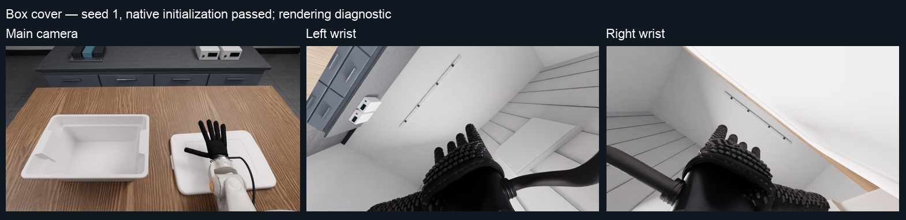
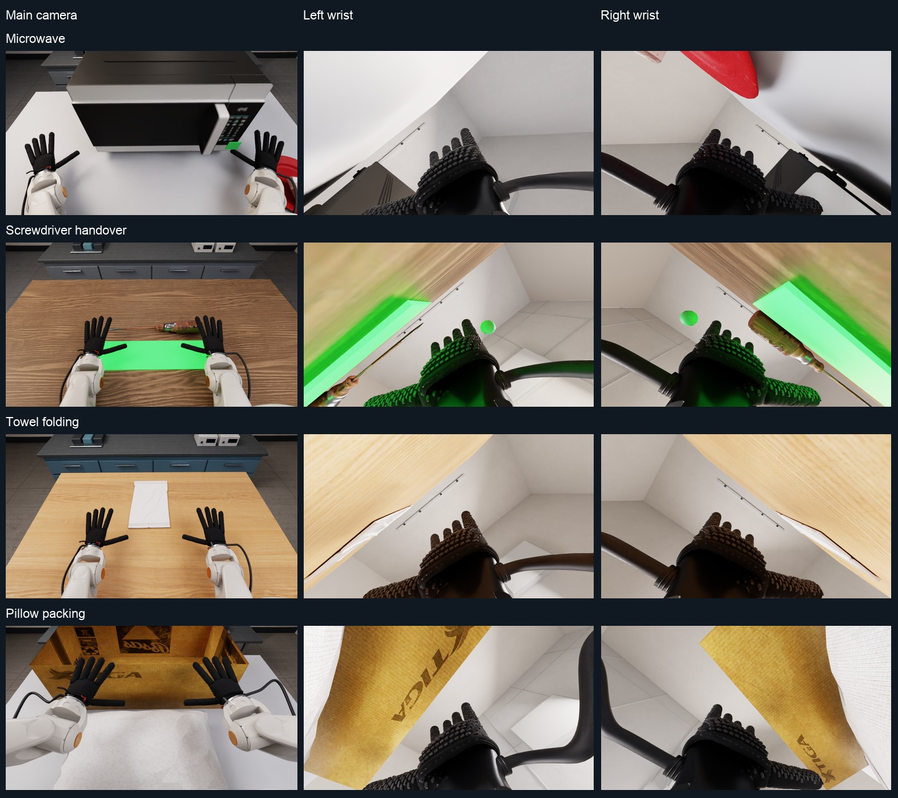

# Release runtime validation

## Publication consistency audit — 2026-10-20

**Repository history cleanup is complete.** The 15 excluded Tianji files were
removed from the three affected historical commits. All 11 commits reachable
from the cleaned `main` were checked, and GitHub's `main` was verified at
`70febed572a6d51ff4b403e0f8e779ea5f0a666a`. Its current file tree is unchanged.
This verifies reachable history, not physical erasure of unreachable objects
or caches held by GitHub. Existing clones must realign to the cleaned history
and must not republish old branches.

**Public visibility still requires a repository administrator:** the current
account has push permission but no admin permission. The visibility API request
returned HTTP 404; the repository remains private.

The maintained `handson/tests` CPU suite passes **1,887 tests and nine
subtests**, with 11 optional-dependency skips and no failures on macOS arm64 /
Python 3.11.17. All 66 PhysX CPU factories, 531 bundled robot-record files,
the rendering manifest and `pip check` pass. Local Markdown links in the root
documentation and `docs/` resolve after the historical simulator guide repair.

EVAL-Gen03's YAML, summary and native UI now describe the yellow mustard bottle
already used by its scene, task config and evaluation language. Its historical
soap-dispenser attribution explains that distinction. The native 120-second
collection limit and the evaluator's 222-action / 7.4-second budget are
documented separately; geometry, dynamics, resets and scoring are unchanged.

Gitleaks reviewed the working tree, all nine commits reachable from the release
base and seven tracked ZIP archives. The 11 working-tree and 13 history
findings were class names, API objects, hashes, a public asset ID and a completed
historical run's local ownership nonce; no service credential was confirmed.

The broader historical `scripts/tests` directory still has nine collection
errors for modules absent from this release. The contributor guide now points
to the maintained release suite and states that limitation. Earlier GPU and
full NVIDIA-stack limitations below remain; this audit does not add GPU or
learned-policy evidence. See the [audit receipt](validation/publication-audit-20261020.json).

## Current publication integration — 2026-10-17

The release now bundles the complete paper ROKAE/Wuji robot and original
rendering resources. All 16 AR5-08 STL meshes match a pinned public
`rokae_description` 0.0.5 package that explicitly declares Apache-2.0.
Its declaration, license text, model-name mapping and benchmark parameter
differences are retained; see [ROKAE provenance](robot-assets.md#rokae-ar5-08-provenance).
Tianji remains an optional user download. The older 2026-10-15 distribution
audit below is historical and is superseded for ROKAE availability.

The shared Newton evaluator, deployment repairs and CPU regression workflow are
included. Newton currently supports only `t09_insert_peg` and
`t26_place_fruit_in_bucket`; its earlier bounded GPU/policy evidence remains
separate from PhysX paper results. This integration introduces no new GPU or
all-task policy-success claim.

Renaming changed asset metadata and a contract namespace, but left seven hash
bindings stale. The repair compares against the pre-rename source, verifies
that geometry and numerical settings did not change, and updates the checksums
without weakening validation. See [the checksum audit](validation/branding-checksums.json).
The recording-manifest test now uses a real, small temporary Git repository;
its dirty-state and commit assertions no longer depend on the size of a
developer's uncommitted diff.

The current macOS CPU run passed 1,886 tests and nine subtests, with 11 optional
Torch skips. One subprocess import exceeded its 15-second limit while package
I/O was running; the unchanged test passed alone in 4.73 seconds. Thus 1,887
unique tests passed across that run and recheck. Both archives exclude all 15
Tianji paths even when present in the build tree. A relocated pip installation
validates 531 robot-record files, the complete rendering bundle, and all 66
PhysX plus two Newton CPU factories. Six source URDF rebuilds also match.
Details and limitations are in [the integration receipt](validation/release-readiness.json).

## Historical external-asset audit — 2026-10-15

At this historical snapshot, Tianji M6-CCS and ROKAE AR5-08 required user-supplied files. The source tree,
wheel and source distribution exclude 89 paths, including duplicate AR5-08
geometry and converted arm visual layers. SHA256 manifests, model identities,
task integration and the original rendering profile are retained. Tianji's
pinned upstream source can be expanded locally. No matching complete public
AR5-08 benchmark bundle was verified; the official repository inspected contains
AR5-07, which is not substituted. See [acquisition instructions](robot-assets.md#external-assets).

The clean Linux/Python 3.11 suite passed **1,865 tests and nine subtests**, with
18 skips: ten require Torch and eight require the external ROKAE bundle.
After importing both external models, all **49 focused tests** passed. The final
seven external-asset regression tests also passed after correcting the package
exclusions. All 66 CPU factories passed.

The final wheel and source distribution were built with all 89 external paths
present locally; neither archive includes them. The wheel retains all 451
recorded bundled robot files and 80 bundled rendering files with matching hashes.
Its relocated installation validates nine bundled models before import, and all
11 models plus the complete original rendering manifest after import. These are
asset/CPU checks; no new GPU rollout was performed for this distribution change.

The earlier robot and GPU results below describe the complete author
installation **before this distribution split**. They are historical validation,
not proof that a clean public checkout can run without the external arm bundle.
Historical distribution/import checks are recorded in
[the distribution receipt](validation/robot-asset-distribution.json).

## Robot assets and standalone dynamics — 2026-10-15

The robot catalog includes the paper figure's exact arm models, three paper
hand families, and the existing Panda/Allegro assets. Checks cover 486 recorded
files, portable resource paths, URDF joint graphs, eight reproducible URDF
expansions, and seven existing MJCF model/side imports. The expanded CPU suite
passed **1,867 tests, 10 skips and nine subtests** on Linux/Python 3.11.16;
the final robot-focused suite passed all **25 tests**.

KUKA KR6 R700 sixx and FANUC LR Mate 200iD receive explicit estimated inertias;
ABB IRB120 retains its upstream inertias. All three receive positive effort
limits and force-drive gains in separate simulation profiles. Their standalone
Isaac Sim 5.1 checks cover fixed-base gravity holding and bounded joint motion,
with actual physics-clock checks. They do not qualify new arm/hand combinations
for the 66-task evaluator. Source attribution, remaining license provenance
gaps, assumptions and commands are in [robot assets](robot-assets.md); exact
results and validation scope are in the [receipt](validation/robot-assets.json).

## Deployment repair verification — 2026-10-15

The deployment-repair source, before the robot-asset additions above, passed
the complete `handson/tests` suite on Linux x86_64
with Python 3.11.16: **1,842 passed, 10 skipped, zero failures or collection
errors**, plus nine passed model-profile subtests. The ten skips all require
Torch, which is absent from the isolated CPU test environment. All **66 CPU
factories** passed, the rendering manifest and **98 asset hashes** verified,
and `pip check` reported no broken requirements in that environment.

The deployment repair includes:

- Python 3.11 simulator requirements, compatible HandsOn dependency pins, a
  reproducible CPU package lock, and a CPU regression CI workflow.
- Removal of 87 configurations for unregistered tasks. The evaluation config
  directories now contain 66 main, eight object-randomization and eight
  full-randomization configurations, all pointing to released tasks.
- Clear CLI errors for invalid task YAML and standard shell exit codes for
  crashed workers; SIGABRT now produces 134 instead of 250.
- Replay certification aligned with the recorder's diagnostic contact-metric
  schema, corrected BC012 task-development imports, and JSON-safe reporting of
  unavailable contact metrics in the scrub-and-fill task. Internal checker
  state, physical parameters, rendering, reset thresholds and success
  conditions are unchanged.

Tests for removed prototypes, removed MuJoCo environments, private collection
tools and unshipped acceptance archives were retired. Tests for retained tasks
were migrated to the shipped task contracts, assets and interfaces, with new
boundary and failure-path checks. The [test migration ledger](validation/test-migration.json)
lists 383 removed or replaced top-level test functions and 31 new or renamed
functions; parameterized case counts differ. This changes the test population,
so raw pass counts do not measure improvement against the external report's
1,733 passes, 410 failures and three collection errors.

The external report's `t03_cover_box`, seed 1, PhysX CUDA error 700 remains
**unresolved on RTX 4090 / driver 580.178.04**. A new comparison using the
unmodified release source completed 90 actions on RTX 5090 / driver
570.153.02, with all three four-frame videos decoded and inspected. That GPU
environment used NumPy 1.26.4; it does not validate the new dependency pins or
establish the cause of the 4090 failure. No new all-task GPU run or wheel build
was performed for this repair.

The full NVIDIA dependency declarations also retain an upstream
FastAPI/Starlette conflict. The CPU lock excludes Isaac Sim/Lab; its clean
`pip check` does not certify installation of the complete NVIDIA stack from an
empty machine. Trained checkpoints remain external inputs, and no learned-policy
success scores were reproduced in this repair.

See the [installation instructions](installation.md),
[CI workflow](../.github/workflows/cpu-tests.yml), and
[machine-readable repair receipt](validation/deployment-repair.json).
The earlier GPU, wheel and interface checks below remain historical evidence
with their original scope and results.

## Earlier all-task GPU diagnostics

The earlier runtime diagnostics covered **all 66 tasks** using Isaac Sim 5.1 and Isaac Lab 2.3.2: 65 completed with seed 0, and `t03_cover_box` completed a supplementary check with seed 1. Each completed diagnostic executed 90 held measured actions and decoded all three camera videos. These are not learned-policy success scores.

Each completed attempt verified the detailed robot, cables, station and room before physics initialization, all 60 robot visual references, unchanged physical-scene attributes, and an actual 30 Hz physical action clock. The videos contain frames at actions 0, 30, 60 and 90. Wall-clock throughput is separate.

All 198 videos decoded successfully. All 66 tasks matched the three-view pose, intrinsic and lens contracts in their saved camera receipts, with no wrist-camera warnings during capture.

The original seed-0 batch completed 65/66 tasks. Its initialization rejection remains recorded separately and does not count as a model failure:

- `t03_cover_box` — native initialization rejected. At seed 0, task-body angular velocity was 0.00255763 rad/s against the original 0.002 rad/s limit at the 39-second timeout. The threshold is unchanged.

For the supplementary check, seed 1 was fixed before execution as the next sequential seed. It passed the original initialization gate, completed all 90 actions, and exited cleanly. The installed package is unchanged. This supplements rendering coverage; it does not replace the rejected seed-0 attempt or establish model success. See the [seed-1 receipt](validation/cover-box-seed1.json).

Earlier attempts are retained in the machine-readable history, including native sponge initialization rejection and attempts that never started because temporary storage was exhausted. The final runs use dedicated temporary storage. No initialization threshold was relaxed. The all-task overview labels the supplementary seed explicitly.





[All-task image overview](pics/all-task-rendering.jpg) · [Original seed-0 receipts and attempt history](validation/default-render.json) · [Box-cover seed-1 receipt](validation/cover-box-seed1.json)

## Earlier package and CPU checks

- All 66 CPU factories passed from the relocated wheel.
- All 5,681 package files matched the source; no missing or differing file. Rendering asset hashes passed after relocation.
- After the original seed-0 batch, the 5,684 installed package/client files still matched the audited wheel, with no missing, changed or unexpected file. All 5,684 files were checked against the same wheel again before the seed-1 supplement, with no mismatch.
- All 107 transplanted component hashes matched their provenance manifest.
- Public filenames and text contain no retired rendering-version name.
- The full CPU suite then had 1,460 passes, 289 failures, 5 skips and 6 collection errors. The unchanged baseline had 1,289 passes, 426 failures, 5 skips and 6 collection errors; no new failing test IDs were introduced in that comparison. The full suite preceded the final paired-base/visibility/camera changes; the final focused suite had 98 passes and two existing failures, followed by these installed-wheel GPU checks. The repository test suite was not green at that stage; the current CPU results are recorded above.

Wheel SHA256: `651e493925face623a5a94b360b0462e0b93b006929a0c29c5755b88c9c82238`.

## Reproduce

Install the package into the documented Isaac Sim/Lab environment and ensure `ffmpeg` is on `PATH`. Each attempt needs a new output directory.

```bash
python -m handson.evaluation --check
python -m handson.evaluation --task t12_load_and_start_microwave \
  --diagnostic-steps 90 --seed 0 --output outputs/microwave
python -m handson.evaluation --task t03_cover_box \
  --diagnostic-steps 90 --seed 1 --output outputs/box-seed1
```

Native reset rejection remains a valid initialization outcome and must be recorded separately from policy outcomes. Public task names change task-keyed random draws; these checks do not recreate manuscript seeds or certify every success path. Policy checkpoints and actual learned-policy rollouts are required to measure success rates.

## Task matrix

| Task | Seed | Latest diagnostic | Actions | Three videos decoded |
| --- | ---: | --- | ---: | --- |
| `eval_comb01_cover_pitcher_and_box` | 0 | diagnostic completed | 90 | yes |
| `eval_comb02_open_laptop_and_click_mouse` | 0 | diagnostic completed | 90 | yes |
| `eval_comb03_pass_block_and_close_box` | 0 | diagnostic completed | 90 | yes |
| `eval_comb04_place_fruit_and_photograph_logo` | 0 | diagnostic completed | 90 | yes |
| `eval_comb05_scrub_bottle_then_fill_cup` | 0 | diagnostic completed | 90 | yes |
| `eval_comb06_season_and_stir` | 0 | diagnostic completed | 90 | yes |
| `eval_flex01_compress_sponge_into_mug` | 0 | diagnostic completed | 90 | yes |
| `eval_flex02_fold_towel_twice` | 0 | diagnostic completed | 90 | yes |
| `eval_flex03_pack_pillow` | 0 | diagnostic completed | 90 | yes |
| `eval_gen01_cover_lunchbox` | 0 | diagnostic completed | 90 | yes |
| `eval_gen02_open_trash_bin` | 0 | diagnostic completed | 90 | yes |
| `eval_gen03_orient_bottle_upright` | 0 | diagnostic completed | 90 | yes |
| `eval_gen04_pass_glue_stick` | 0 | diagnostic completed | 90 | yes |
| `eval_gen05_set_mixer_knobs` | 0 | diagnostic completed | 90 | yes |
| `eval_gen06_spray_shoe` | 0 | diagnostic completed | 90 | yes |
| `eval_gen07_stack_boxes` | 0 | diagnostic completed | 90 | yes |
| `t01_align_blocks_in_midair` | 0 | diagnostic completed | 90 | yes |
| `t02_connect_charger_and_cable` | 0 | diagnostic completed | 90 | yes |
| `t03_cover_box` | 1 | diagnostic completed (supplement) | 90 | yes |
| `t04_cover_pitcher` | 0 | diagnostic completed | 90 | yes |
| `t05_fill_cup` | 0 | diagnostic completed | 90 | yes |
| `t06_fit_device_cover` | 0 | diagnostic completed | 90 | yes |
| `t07_flip_sponge` | 0 | diagnostic completed | 90 | yes |
| `t08_hammer_nail` | 0 | diagnostic completed | 90 | yes |
| `t09_insert_peg` | 0 | diagnostic completed | 90 | yes |
| `t10_lift_carton` | 0 | diagnostic completed | 90 | yes |
| `t11_line_up_blocks` | 0 | diagnostic completed | 90 | yes |
| `t12_load_and_start_microwave` | 0 | diagnostic completed | 90 | yes |
| `t13_load_cans` | 0 | diagnostic completed | 90 | yes |
| `t14_move_and_click_mouse` | 0 | diagnostic completed | 90 | yes |
| `t15_open_drawers` | 0 | diagnostic completed | 90 | yes |
| `t16_open_laptop` | 0 | diagnostic completed | 90 | yes |
| `t17_open_latched_door` | 0 | diagnostic completed | 90 | yes |
| `t18_open_micropipette_box` | 0 | diagnostic completed | 90 | yes |
| `t19_orient_cup_upright` | 0 | diagnostic completed | 90 | yes |
| `t20_pass_and_orient_pen` | 0 | diagnostic completed | 90 | yes |
| `t21_pass_block` | 0 | diagnostic completed | 90 | yes |
| `t22_pass_screwdriver` | 0 | diagnostic completed | 90 | yes |
| `t23_photograph_logo` | 0 | diagnostic completed | 90 | yes |
| `t24_place_ball_in_bowl` | 0 | diagnostic completed | 90 | yes |
| `t25_place_cup_on_plate` | 0 | diagnostic completed | 90 | yes |
| `t26_place_fruit_in_bucket` | 0 | diagnostic completed | 90 | yes |
| `t27_place_largest_fitting_ball` | 0 | diagnostic completed | 90 | yes |
| `t28_place_tableware` | 0 | diagnostic completed | 90 | yes |
| `t29_place_wine_glass` | 0 | diagnostic completed | 90 | yes |
| `t30_pour_seasonings` | 0 | diagnostic completed | 90 | yes |
| `t31_prepare_coffee` | 0 | diagnostic completed | 90 | yes |
| `t32_press_soap_pump` | 0 | diagnostic completed | 90 | yes |
| `t33_reposition_marker_grasp` | 0 | diagnostic completed | 90 | yes |
| `t34_roll_ball_through_gate` | 0 | diagnostic completed | 90 | yes |
| `t35_rotate_propeller` | 0 | diagnostic completed | 90 | yes |
| `t36_scoop_marbles` | 0 | diagnostic completed | 90 | yes |
| `t37_scrub_bottle` | 0 | diagnostic completed | 90 | yes |
| `t38_set_dual_knobs` | 0 | diagnostic completed | 90 | yes |
| `t39_set_timer` | 0 | diagnostic completed | 90 | yes |
| `t40_slide_knife_blade` | 0 | diagnostic completed | 90 | yes |
| `t41_sort_nested_cups` | 0 | diagnostic completed | 90 | yes |
| `t42_sort_objects` | 0 | diagnostic completed | 90 | yes |
| `t43_squeeze_scissors` | 0 | diagnostic completed | 90 | yes |
| `t44_stack_blocks` | 0 | diagnostic completed | 90 | yes |
| `t45_stir_pot` | 0 | diagnostic completed | 90 | yes |
| `t46_store_charger` | 0 | diagnostic completed | 90 | yes |
| `t47_trigger_drill_on_block` | 0 | diagnostic completed | 90 | yes |
| `t48_unfold_fan` | 0 | diagnostic completed | 90 | yes |
| `t49_unfold_ruler` | 0 | diagnostic completed | 90 | yes |
| `t50_water_plant` | 0 | diagnostic completed | 90 | yes |

## Earlier interface refactor verification

The public policy factory now exposes measured EEF52 state and actions for all
66 tasks. CPU construction was checked with images both enabled and disabled,
alongside the native evaluator factory. All 578 supported task/model dispatch
combinations passed with fixture policies; the 16 unsupported DP Transfer
combinations were rejected.

The expanded Linux Python 3.11 regression run then reported 250 passed, one skipped
and seven failed, plus nine passed model-profile subtests. The same seven
failures were reproduced with the pre-refactor code: six require a Git
executable absent from the test host; one references the historical unregistered
`e01_fold_garment` task. These were the results before the deployment repair
recorded above.

Comparison with the pre-refactor source verified 54 native factory files
(modulo method renaming), all 13 original EEF52 functions, nine model metadata
profiles, and 107 goal variants at three seeds each. Native model adapters,
preprocessing and renderer implementation files were unchanged. The wheel
inclusion manifest contains the relocated task data and new modules; a new
full wheel or GPU rollout was not produced by this refactor.

See the [machine-readable receipt](validation/interfaces.json) and the
[public interface and extension guide](custom_policy_integration.md#python-environment-interface).
