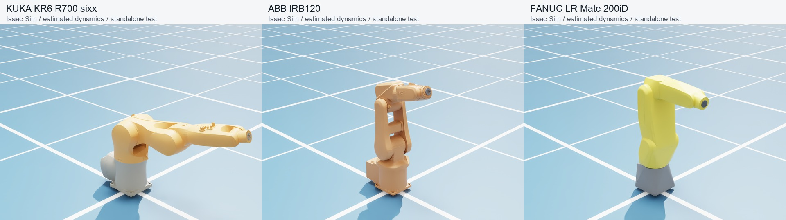

# Robot assets and attribution

The catalog identifies the arm models used in the paper's overview figure and
three paper hand families, plus the existing Panda and Allegro descriptions.
Ten models are bundled. Tianji M6-CCS requires user-supplied files because its
exact BSD license variant and text have not been established.
Sources, license evidence and SHA256 hashes are recorded in `SOURCE.json`.

**Asset availability and benchmark execution are separate.** The released
66-task evaluator, EEF52 action interface and reported experiments use
**ROKAE AR5-5_08 + Wuji Hand 1 + PhysX**. Adding an asset does not enable that
robot in the evaluator. Alternative arms/hands need mounting transforms,
controllers or retargeting, collision/contact qualification, resets and task
success validation before they can be used for benchmark scores. The catalog's
`benchmark_qualified` flag identifies members of the existing paper pair; it
does not certify arbitrary combinations or the standalone URDF importer.

## Included descriptions

| Catalog ID | Exact model | Format / sides | Independent joints per arm or hand | Source / license |
|---|---|---|---:|---|
| `rokae_ar5` | ROKAE AR5-5_08 | URDF, left/right | 7 | [Pinned public description mirror](https://github.com/Airomantic/ar3_ws/tree/49a02dbf4af2412612d2b2d6af9704d47efb4322/src/rokae_ros2-v0.0.5/rokae_description); package declares Apache-2.0 |
| `tianji_m6_ccs` | Tianji Marvin M6-CCS | External URDF, left/right | 7 | [fiveages-sim description](https://github.com/fiveages-sim/robot-descriptions-tianji/tree/b9e73d4b50a071457fe08e5c710f0bcda7731b29); upstream declares BSD, text/variant absent |
| `kuka_kr6_r700` | KUKA KR6 R700 sixx | URDF | 6 | [ROS-Industrial](https://github.com/ros-industrial/kuka_experimental/tree/8d9292b04a22628b1b78d989e2ddd3abb913bf92/kuka_kr6_support); Apache-2.0 |
| `ur5e` | Universal Robots UR5e | URDF | 6 | [Universal Robots](https://github.com/UniversalRobots/Universal_Robots_ROS2_Description/tree/d4042c1f5123c86645cc5dbd650b4f461f697ee9); BSD-3-Clause |
| `abb_irb120` | ABB IRB120-3/0.58 | URDF | 6 | [ROS-Industrial](https://github.com/ros-industrial/abb/tree/45f4769d826cf3ac62a65495f2db67b78b0c81df/abb_irb120_support); Apache-2.0 |
| `fanuc_lrmate200id` | FANUC LR Mate 200iD | URDF | 6 | [ROS-Industrial](https://github.com/ros-industrial/fanuc/tree/d8f42bd73584b255df87098395512538882caea1/fanuc_lrmate200id_support); BSD-3-Clause |
| `wuji1` | Wuji Hand 1 | MJCF, left/right | 20 | [Wuji Technology](https://github.com/wuji-technology/wuji-description/tree/829c9aa27cb12c3a49d5b8d63c9869dd8f656702); MIT |
| `wuji2` | Wuji Hand 2 beta1 | MJCF, left/right | 20 | [Wuji Technology](https://github.com/wuji-technology/wuji-description/tree/8271644a78d69ed9a4adcf9165d882c64ad33dfa); MIT |
| `sharpa_wave` | Sharpa Wave | URDF, left/right | 22 | [Sharpa Robotics](https://github.com/sharpa-robotics/sharpa-urdf-usd-xml/tree/0d19cac602f46456b819e4b6a2c09a74982c9a3e); Apache-2.0 |
| `panda` | Franka Emika Panda (existing asset) | MJCF | 7 arm + 1 coupled gripper | [franka_ros](https://github.com/frankaemika/franka_ros); Apache-2.0 |
| `allegro` | Wonik Allegro Hand V3 (existing asset) | MJCF, left/right | 16 | [SimLab Robotics](https://github.com/simlabrobotics/allegro_hand_ros); BSD-2-Clause |

Industrial arms have one physical model, selected with the catalog's default
`side="right"`; this is a lookup convention, not a mirrored right-arm variant.
Left/right entries exist only when distinct descriptions are supplied. Tianji
uses the `M6_CCS` macro with `direction=1` / `-1` and no end effector. Its pinned
revision is the same one used for the paper figure. KUKA is the six-axis KR6
R700 sixx shown in that figure.

## Inspect and load

Listing and checking bundled models need no simulator, ROS installation,
network access or demonstration download. Import external files first to load
Tianji. An all-model `--check` reports absent external models and
`complete: false`; checking a specific absent model exits with an error:

```bash
python -m handson.robots
python -m handson.robots --check
python -m handson.robots --sources
python -m handson.robots --robot tianji_m6_ccs
python -m handson.robots --robot tianji_m6_ccs --side right \
  --prepare-urdf outputs/robots/tianji.urdf
```

The prepared URDF contains absolute resource paths suitable for a local
importer's file picker. The output must be a new file outside the installed
package. Recreate it after moving the installation; distributed URDFs retain
relative paths. The function changes resource locations only, preserving
joint limits, inertias, origins and collision definitions.

```python
from handson.robots import get_robot_asset

arm = get_robot_asset("tianji_m6_ccs", side="right")
urdf = arm.prepare_urdf("outputs/robots/tianji-right.urdf")
hand = get_robot_asset("wuji1", side="left")
print(hand.format, hand.path)  # existing MJCF entry
```

This is a description resolver, not a task factory or a universal importer.
An importer must support each mesh format (STL, COLLADA and Tianji's GLB).
KUKA and FANUC lack upstream inertias. ABB includes upstream inertias, but all
three have zero effort placeholders. Explicit simulation profiles now supply
estimated masses/inertias where missing, positive effort limits and joint
drives; the raw descriptions remain available separately. Original MJCF files
remain unchanged. The catalog exposes portable exports for
Wuji 2, Panda and Allegro; those fix mesh paths and Allegro right mesh names.

## Sources, modifications and licenses

Bundled descriptions include the required meshes and original source files under
`handson/assets/robots/<id>/source/`. This is a source subset for rebuilding the
listed models, not a complete ROS package installation. Upstream README files
may describe additional models or ROS components that are not included.

The [catalog](../handson/handson/assets/robots/catalog.json) links each
`SOURCE.json`, including full revisions, upstream Git blob identities, local
SHA256 checksums and modification notes. Upstream license and copyright notices
are retained alongside the files. Sharpa's Apache license notice and NOTICE
are accompanied by the full Apache-2.0 text. The repository MIT license does not
relicense third-party robot assets.

The source-description modifications are xacro expansion, portable resource paths, and Sharpa's
optional MuJoCo mesh-directory settings. ROKAE's standalone exports resolve
paths to bundled meshes; retained benchmark parameter differences from the
public reference are documented below. Native task integration is unchanged. Wuji 1's 52 existing mesh files match the pinned official repository;
its four release MJCF files are adaptations. Wuji 2 retains its prior source
commit and MIT notice. Panda and Allegro retain their original asset attribution;
the exact upstream revisions for those historical imports were not recorded.

Tianji source descriptions, geometry and generated URDFs are excluded from
source releases, wheels and source distributions. Its pinned `package.xml`
declares `BSD`, but supplies neither the license text nor the variant. The
declaration is preserved; it is not treated as a completed license record.

Use the [BibTeX references](robot-assets.bib) when describing these third-party
robot models. Citation complements the retained license notices; it does not
replace them.

## External assets

Download assets from the linked upstream sources under their applicable terms.
HandsOn does not download them automatically or grant additional rights. Local
imports are excluded from future package builds and ignored by Git. The installer
verifies every required SHA256 before copying, refuses a different model or an
incomplete set, and never overwrites a conflicting file. Use a writable virtual
environment or the documented editable installation.

### Tianji Marvin M6-CCS

Obtain the [pinned source ZIP](https://github.com/fiveages-sim/robot-descriptions-tianji/archive/b9e73d4b50a071457fe08e5c710f0bcda7731b29.zip)
or use the [source repository](https://github.com/fiveages-sim/robot-descriptions-tianji/tree/b9e73d4b50a071457fe08e5c710f0bcda7731b29).
The upstream `package.xml` declares BSD without its text or variant; downloading
does not resolve that ambiguity. After obtaining the files for your use, unpack
the ZIP outside the HandsOn checkout and run:

```bash
python -m pip install xacro==2.1.1
python -m handson.robots --robot tianji_m6_ccs \
  --install-from /path/to/robot-descriptions-tianji-b9e73d4b50a071457fe08e5c710f0bcda7731b29
python -m handson.robots --robot tianji_m6_ccs --check
python -m handson.robots --robot tianji_m6_ccs \
  --prepare-urdf outputs/robots/tianji.urdf
```

The installer uses only the required pinned files and expands both URDFs locally.
It does not execute upstream launch scripts or install a ROS stack.

## ROKAE AR5-08 provenance

The paper evaluator includes `AR5-5_08L-W4C6C11` and
`AR5-5_08R-W4C1C9-ZY2`, their standalone/native descriptions and all converted
arm visual layers. No separately obtained prepared arm bundle is needed.

All **16 arm STL meshes are byte-identical** to the left/right
`AR5-5_08*-W4C1C5` meshes in the pinned
[public rokae_description 0.0.5 mirror](https://github.com/Airomantic/ar3_ws/tree/49a02dbf4af2412612d2b2d6af9704d47efb4322/src/rokae_ros2-v0.0.5/rokae_description).
Its [package.xml](https://github.com/Airomantic/ar3_ws/blob/49a02dbf4af2412612d2b2d6af9704d47efb4322/src/rokae_ros2-v0.0.5/rokae_description/package.xml)
explicitly declares **Apache License 2.0** and lists a `rokae.com` maintainer.
This is a third-party mirror, not an official manufacturer-hosted repository;
there is no separate root license file. We retain the exact package declaration,
full Apache-2.0 text, source reference URDFs and file-by-file SHA256 mapping in
[`rokae_ar5/SOURCE.json`](../handson/handson/assets/robots/rokae_ar5/SOURCE.json).

Identical meshes do not establish identical robot dynamics. The seven joint
origins/axes match, but the benchmark retains its existing masses, centers of
mass, inertias, effort limits and wrist ranges; it also adds a camera/flange
assembly and changes names/resource paths. The full differences are recorded in
[`parameter-comparison.json`](../handson/handson/assets/robots/rokae_ar5/parameter-comparison.json).
These are benchmark configuration values, not a claim of manufacturer-certified
specifications. The public reference is not substituted into the evaluator.
The existing geometry, converted USD layers and paper rendering hashes remain
unchanged. Modified-description notices cover these benchmark adaptations.

```bash
python -m handson.robots --robot rokae_ar5 --check
python -m handson.sim.isaaclab.render_assets
```

The legacy AR5-07 subset has separate provenance matching the
[official ROKAE repository](https://github.com/RokaeRobot/rokae_ros2).
It is not used to replace the paper's AR5-08 arms.

## Rebuild and validation scope

The six bundled URDFs can be rebuilt offline from the packaged source subset
(four industrial arms and left/right Sharpa; Tianji expands during local import). Use a separate
build environment with `xacro==2.1.1`:

```bash
python -m pip install xacro==2.1.1
python scripts/rebuild_robot_descriptions.py --check
```

Omit `--check` to regenerate the URDFs and their generated-file hashes. The
builder rejects modified pinned upstream files. Runtime loading does not
require xacro. `python -m handson.robots --check` verifies bundled and installed
external file hashes, URDF joint graphs and mesh/texture/buffer dependencies, including
COLLADA and GLB references. MJCF entries receive file-hash and resource-path checks;
this command does not certify their dynamics or controllers. Absent external
models are reported separately and do not count as verified model imports.

See the [validation receipt](validation/robot-assets.json) for tested versions,
package relocation checks and the limits of this asset-only validation.

## Standalone industrial-arm simulation

KUKA KR6 R700 sixx, ABB IRB120 and FANUC LR Mate 200iD have explicit
`simulation.json` profiles. These are **simulation estimates, not identified
manufacturer dynamics**. KUKA has a 50 kg total link-mass allocation and FANUC
25 kg; per-link values, collision-box dimensions, centers of mass and inertias
are recorded in those files. The box formula is
`Ixx = mass * (dy² + dz²) / 12`, with cyclic permutations for the other axes.
ABB's supplied masses and inertia tensors are retained. Joint effort estimates
replace only the original zero placeholders. Collision and visual geometry,
joint axes, position limits and velocity limits are preserved.

In the installed Isaac Sim 5.1 environment:

```bash
python -m handson.robots.simulation --robot kuka_kr6_r700 \
  --headless --output outputs/kuka-simulation
python -m handson.robots.simulation --robot abb_irb120 \
  --headless --output outputs/abb-simulation
python -m handson.robots.simulation --robot fanuc_lrmate200id \
  --headless --output outputs/fanuc-simulation
```

Each command imports a private copy, fixes the base, uses gravity, holds the
initial pose for three seconds, then follows a small sinusoidal joint target
for six seconds. Physics runs at 240 Hz and targets at 60 Hz. It saves a USD
scene, images, joint trajectory and `result.json`, and fails if hold/tracking
error, motion range, finite-state or joint-limit checks fail. Self-collision is
disabled for this standalone control diagnostic. These checks do not validate
payload capacity, self-contact, arm/hand assembly or benchmark task success.

To use the estimated dynamics in another importer:

```bash
python -m handson.robots --robot kuka_kr6_r700 --simulation \
  --prepare-urdf outputs/robots/kuka-simulation.urdf
```

Without `--simulation`, the exported URDF preserves the original upstream
parameters. The script's joint drive gains are recorded separately in
`simulation.json`; a different importer must configure its drives accordingly.
These gains use force drives and radians; the Isaac importer converts them to
USD angular-drive units and verifies the actual gains after initialization.

To regenerate the recorded box estimates from the packaged collision meshes:

```bash
python -m pip install trimesh==4.8.3
python scripts/build_robot_simulation_profiles.py
```

Final standalone checks completed 2160 physics steps per arm (measured
9.00000047 s). Maximum joint tracking errors were 3.04° for KUKA, 0.86° for
ABB and 1.08° for FANUC, with no joint-limit violations. These tests use CPU
PhysX dynamics with RTX rendering. The [receipt](validation/robot-assets.json)
retains earlier rejected attempts and the final clock/drive readbacks.


